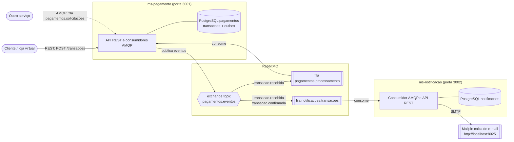
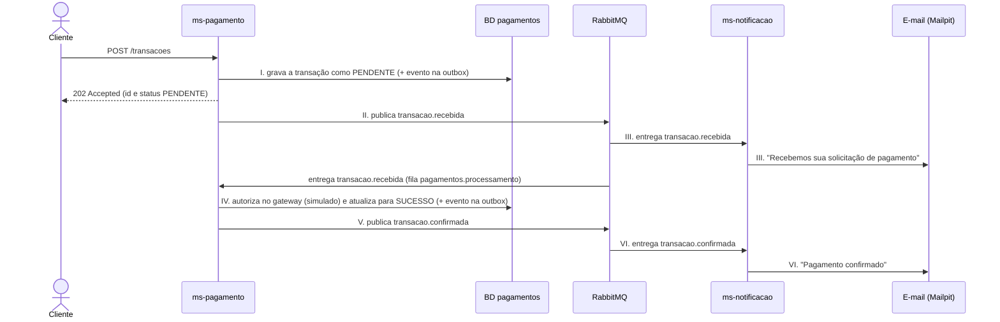
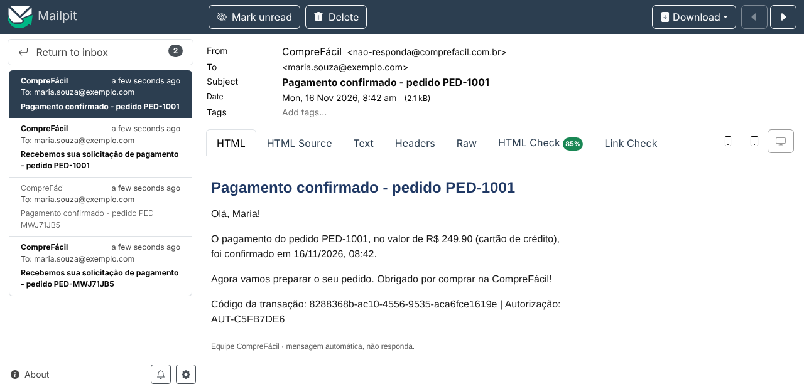
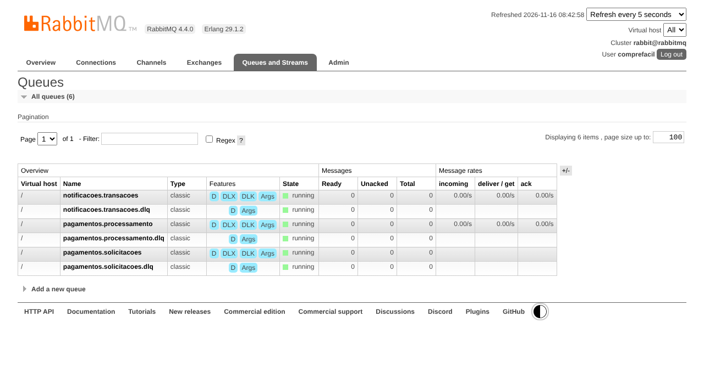
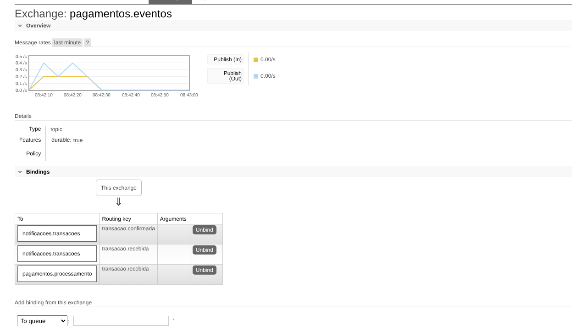

# CompreFácil: microsserviços de pagamento e notificação

Desafio da disciplina **Desenvolvimento de Sistemas Distribuídos (SENAI), parte 2: desenvolvimento**.
Autor: **Gustavo Borges**

São dois serviços em Node.js que rodam de forma **independente** e se comunicam de forma **assíncrona** pelo **RabbitMQ**:

| Serviço | Responsabilidade | Interfaces | Banco |
|---|---|---|---|
| [`ms-pagamento`](ms-pagamento) | Recebe as solicitações de transação, grava com status `PENDENTE`, confirma a transação (`SUCESSO`) e publica os eventos | REST (porta 3001) e AMQP | PostgreSQL próprio (`pagamentos`) |
| [`ms-notificacao`](ms-notificacao) | Consome os eventos de pagamento e avisa o cliente por e-mail | AMQP e REST (porta 3002) | PostgreSQL próprio (`notificacoes`) |

A infraestrutura (dois PostgreSQL, RabbitMQ e um servidor de e-mail de testes) sobe com **docker-compose**.

> Este projeto implementa dois dos sete serviços descritos na proposta de arquitetura da parte 1 do desafio: Pagamentos e Notificações. Como o enunciado pede, a mensageria é o RabbitMQ (na proposta, a referência era o Kafka). Os padrões da proposta foram mantidos: um banco por serviço, transactional outbox, consumidores idempotentes, fila de mensagens mortas (DLQ) e chave de idempotência nas solicitações.

---

## Sumário

1. [Arquitetura](#1-arquitetura)
2. [Fluxo da transação (etapas I a VI)](#2-fluxo-da-transação-etapas-i-a-vi)
3. [Como executar](#3-como-executar)
4. [Como testar o fluxo](#4-como-testar-o-fluxo)
5. [Demonstração da independência dos serviços](#5-demonstração-da-independência-dos-serviços)
6. [Interfaces REST e AMQP](#6-interfaces-rest-e-amqp)
7. [Decisões técnicas](#7-decisões-técnicas)
8. [Testes automatizados](#8-testes-automatizados)
9. [Executar os serviços sem Docker](#9-executar-os-serviços-sem-docker)
10. [Critérios de avaliação](#10-critérios-de-avaliação)
11. [Estrutura do repositório](#11-estrutura-do-repositório)
12. [Problemas comuns](#12-problemas-comuns)

---

## 1. Arquitetura



- Os dois serviços **não se chamam diretamente** e **não compartilham banco de dados**. O único contrato entre eles são as mensagens publicadas no exchange `pagamentos.eventos`.
- O evento `transacao.recebida` segue o modelo **publicação/assinatura**: o RabbitMQ entrega uma cópia para a fila do serviço de notificação, que avisa o cliente, e outra para a fila de processamento do próprio serviço de pagamento, que confirma a transação.
- O **Mailpit** faz o papel do servidor de e-mail. Ele recebe os e-mails enviados pelo serviço de notificação e os mostra numa página web, sem mandar nada para a internet.

## 2. Fluxo da transação (etapas I a VI)



| Etapa do enunciado | Como foi implementada | Código |
|---|---|---|
| **I.** armazena a transação com status pendente | `INSERT` com status `PENDENTE` e, **na mesma transação do banco**, grava o evento `TransacaoRecebida` na tabela `outbox` | [`ms-pagamento/src/transacoes/servico.js`](ms-pagamento/src/transacoes/servico.js) |
| **II.** publica mensagem para a notificação | O relay da outbox publica o evento no exchange `pagamentos.eventos` (routing key `transacao.recebida`) com confirmação do broker | [`ms-pagamento/src/mensageria/outbox-relay.js`](ms-pagamento/src/mensageria/outbox-relay.js) |
| **III.** notificação lê a fila e avisa o recebimento | O consumidor da fila `notificacoes.transacoes` registra a notificação e envia o e-mail "Recebemos sua solicitação de pagamento" | [`ms-notificacao/src/consumidores/eventos-transacao.js`](ms-notificacao/src/consumidores/eventos-transacao.js) |
| **IV.** confirma a transação e atualiza para sucesso | O consumidor da fila `pagamentos.processamento` autoriza a cobrança no gateway simulado (3 s) e faz `UPDATE ... SET status = 'SUCESSO' WHERE status = 'PENDENTE'` | [`ms-pagamento/src/consumidores/processamento.js`](ms-pagamento/src/consumidores/processamento.js) |
| **V.** publica mensagem de confirmação | O evento `TransacaoConfirmada`, gravado na outbox junto com o `UPDATE`, é publicado com a routing key `transacao.confirmada` | [`ms-pagamento/src/mensageria/outbox-relay.js`](ms-pagamento/src/mensageria/outbox-relay.js) |
| **VI.** notificação lê a fila e avisa a confirmação | O mesmo consumidor da etapa III envia o e-mail "Pagamento confirmado" | [`ms-notificacao/src/notificacoes/servico.js`](ms-notificacao/src/notificacoes/servico.js) |

**Por que o fluxo é assíncrono:** a requisição `POST /transacoes` termina na etapa I e responde `202 Accepted`. As etapas II a VI acontecem por mensagens no RabbitMQ, sem que o cliente espere. A confirmação (IV) também é disparada por uma mensagem, e não por um temporizador em memória, então não se perde se o serviço reiniciar no meio do processo.

## 3. Como executar

### Pré-requisitos

- **Docker Desktop** (no Windows, com WSL 2) ou Docker Engine com o plugin Compose. É o único requisito para subir o projeto.
- **Git**, para clonar o repositório.
- **Node.js 22 ou superior**, apenas para rodar o script de teste automático ([seção 4](#4-como-testar-o-fluxo)) ou para rodar os serviços fora do Docker ([seção 9](#9-executar-os-serviços-sem-docker)). Também é possível testar só com PowerShell ou curl.

### Passo a passo

```bash
git clone https://github.com/GustavoBorges130/Desenvolvimento-de-Sistemas-Distribuidos.git
cd Desenvolvimento-de-Sistemas-Distribuidos
docker compose up --build -d
```

Na primeira execução, o Docker baixa as imagens e instala as dependências, o que leva alguns minutos. Para conferir se tudo subiu:

```bash
docker compose ps
```

Todos os contêineres devem aparecer como `running (healthy)`:

```
SERVICE                STATUS
mailpit                Up (healthy)
ms-notificacao         Up (healthy)
ms-pagamento           Up (healthy)
postgres-notificacao   Up (healthy)
postgres-pagamento     Up (healthy)
rabbitmq               Up (healthy)
```

### Endereços

| O quê | Endereço | Acesso |
|---|---|---|
| API do serviço de pagamento | http://localhost:3001 | — |
| API do serviço de notificação | http://localhost:3002 | — |
| Painel do RabbitMQ | http://localhost:15672 | usuário `comprefacil`, senha `comprefacil` |
| Caixa de e-mail (Mailpit) | http://localhost:8025 | — |
| PostgreSQL do pagamento | `localhost:5433`, banco `pagamentos` | usuário e senha `pagamento` |
| PostgreSQL da notificação | `localhost:5434`, banco `notificacoes` | usuário e senha `notificacao` |

### Encerrar

```bash
docker compose down        # para e remove os contêineres (os dados ficam nos volumes)
docker compose down -v     # também apaga os dados dos bancos e do RabbitMQ
```

## 4. Como testar o fluxo

### Opção A: script automático (recomendado)

Com Node.js 22+ instalado, na pasta do projeto:

```bash
node scripts/testar-fluxo.mjs              # solicitação pela API REST
node scripts/testar-fluxo.mjs --via amqp   # solicitação pela fila pagamentos.solicitacoes
```

O script cria uma transação, acompanha as seis etapas consultando as APIs dos dois serviços e a caixa do Mailpit e, no fim, testa a chave de idempotência. Saída real:

```
CompreFácil — teste do fluxo de pagamento (solicitação via REST)

OK        ms-pagamento no ar (UP: postgres UP, rabbitmq UP) +0.0s
OK        ms-notificacao no ar (UP: postgres UP, rabbitmq UP, smtp UP) +0.1s

    POST http://localhost:3001/transacoes → 202 Accepted (a resposta não espera a confirmação)
OK  [I]   transação 7ed83dd3-33a9-42d6-9f81-9e0a2659ea11 armazenada com status PENDENTE +0.1s
OK  [II]  mensagem transacao.recebida publicada no RabbitMQ +0.4s
OK  [III] notificação lida da fila e enviada: "Recebemos sua solicitação de pagamento - pedido PED-MWJ71JB5" → maria.souza@exemplo.com +0.4s
OK  [IV]  transação confirmada: status SUCESSO (autorização AUT-9F699E36) +3.2s
OK  [V]   mensagem transacao.confirmada publicada no RabbitMQ +3.5s
OK  [VI]  notificação lida da fila e enviada: "Pagamento confirmado - pedido PED-MWJ71JB5" → maria.souza@exemplo.com +3.5s
OK        2 e-mails na caixa de entrada do Mailpit (http://localhost:8025): "Pagamento confirmado - pedido PED-MWJ71JB5" e "Recebemos sua solicitação de pagamento - pedido PED-MWJ71JB5" +3.5s
OK        reenvio com a mesma Idempotency-Key devolveu a mesma transação (HTTP 200, sem nova cobrança) +3.5s

Fluxo concluído: da solicitação à notificação de confirmação em 3.1s.
```

### Opção B: manualmente

**PowerShell (Windows):**

```powershell
$corpo = @{
  pedidoId        = "PED-1001"
  valor           = 249.90
  metodoPagamento = "PIX"
  cliente         = @{ id = "10"; nome = "Maria Souza"; email = "maria.souza@exemplo.com" }
} | ConvertTo-Json

$resposta = Invoke-RestMethod -Method Post -Uri http://localhost:3001/transacoes `
  -ContentType "application/json; charset=utf-8" `
  -Headers @{ "Idempotency-Key" = "pedido-1001" } -Body $corpo
$resposta.transacao          # status PENDENTE
$id = $resposta.transacao.id

# Alguns segundos depois:
Invoke-RestMethod http://localhost:3001/transacoes/$id           # status SUCESSO
(Invoke-RestMethod "http://localhost:3002/notificacoes?transacaoId=$id").notificacoes |
  Format-Table tipo, status, assunto, enviadaEm
```

**curl (Git Bash, Linux ou macOS):**

```bash
curl -X POST http://localhost:3001/transacoes \
  -H "Content-Type: application/json" \
  -H "Idempotency-Key: pedido-1002" \
  -d '{"pedidoId":"PED-1002","valor":249.90,"metodoPagamento":"PIX","cliente":{"id":"10","nome":"Maria Souza","email":"maria.souza@exemplo.com"}}'

curl http://localhost:3001/transacoes/<id>
curl "http://localhost:3002/notificacoes?transacaoId=<id>"
```

### O que observar

**1. Os logs dos dois serviços**, com as etapas numeradas:

```bash
docker compose logs -f ms-pagamento ms-notificacao
```

```
11:42:11.239Z INFO  [ms-pagamento] [I] transação 7ed83dd3-… registrada com status PENDENTE (pedido PED-MWJ71JB5, R$ 249,90, via REST)
11:42:11.244Z INFO  [ms-pagamento] [II] publicando evento TransacaoRecebida em pagamentos.eventos (routing key transacao.recebida, transação 7ed83dd3-…)
11:42:11.257Z INFO  [ms-notificacao] [III] mensagem TransacaoRecebida lida da fila notificacoes.transacoes (transação 7ed83dd3-…)
11:42:11.278Z INFO  [ms-pagamento] [IV] autorizando a transação 7ed83dd3-… no gateway de pagamento...
11:42:11.330Z INFO  [ms-notificacao] [III] notificação "Recebemos sua solicitação de pagamento - pedido PED-MWJ71JB5" enviada para maria.souza@exemplo.com
11:42:14.286Z INFO  [ms-pagamento] [IV] transação 7ed83dd3-… confirmada: status atualizado para SUCESSO (AUT-9F699E36)
11:42:14.289Z INFO  [ms-pagamento] [V] publicando evento TransacaoConfirmada em pagamentos.eventos (routing key transacao.confirmada, transação 7ed83dd3-…)
11:42:14.333Z INFO  [ms-notificacao] [VI] mensagem TransacaoConfirmada lida da fila notificacoes.transacoes (transação 7ed83dd3-…)
11:42:14.363Z INFO  [ms-notificacao] [VI] notificação "Pagamento confirmado - pedido PED-MWJ71JB5" enviada para maria.souza@exemplo.com
```

**2. Os e-mails no Mailpit** (http://localhost:8025):



**3. As filas e ligações no painel do RabbitMQ** (http://localhost:15672):





**4. Solicitação pela interface AMQP sem o script:** no painel do RabbitMQ, abra *Queues and Streams* → `pagamentos.solicitacoes` → *Publish message*. Em *Properties*, informe `message_id` = `amqp-1` (usado como chave de idempotência) e `content_type` = `application/json`. Em *Payload*, cole o mesmo JSON aceito pelo `POST /transacoes`.

## 5. Demonstração da independência dos serviços

Os comandos abaixo mostram que cada serviço continua funcionando quando o outro (ou o próprio broker) está fora do ar, e que nenhuma mensagem se perde. Todos os cenários foram executados e conferidos.

> No PowerShell, escreva `curl.exe` em vez de `curl` (no Windows PowerShell, `curl` é um apelido de outro comando) ou use `Invoke-RestMethod`.

### a) Serviço de notificação parado: o pagamento segue normalmente

```bash
docker compose stop ms-notificacao
```

Crie uma transação (seção 4, opção B) e consulte-a com `GET /transacoes/:id`. Ela é criada e chega a `SUCESSO` normalmente. As duas mensagens para a notificação ficam guardadas na fila durável:

```bash
docker compose exec rabbitmq rabbitmqctl list_queues name messages consumers
# notificacoes.transacoes   2   0     ← 2 mensagens esperando, nenhum consumidor
```

```bash
docker compose start ms-notificacao
```

Assim que o serviço volta, ele consome as duas mensagens na ordem certa e o cliente recebe os dois e-mails.

### b) Serviço de pagamento parado: a notificação continua no ar

```bash
docker compose stop ms-pagamento
curl http://localhost:3002/health          # {"status":"UP", ...}
curl http://localhost:3002/notificacoes    # histórico continua disponível
docker compose start ms-pagamento
```

### c) RabbitMQ parado: o pagamento continua aceitando solicitações

```bash
docker compose stop rabbitmq
# crie uma transação (seção 4, opção B): resposta 202, status PENDENTE
curl http://localhost:3001/health
# {"status":"DEGRADADO","dependencias":{"postgres":"UP","rabbitmq":"DOWN"},"outbox":{"eventosPendentes":1}}
docker compose start rabbitmq
```

O evento fica guardado na tabela `outbox`. Quando o broker volta, os serviços reconectam sozinhos e o relay publica o evento pendente. O fluxo segue até o e-mail de confirmação.

## 6. Interfaces REST e AMQP

### ms-pagamento: REST (porta 3001)

| Método e rota | Descrição | Respostas |
|---|---|---|
| `POST /transacoes` | Solicita uma transação. Header opcional `Idempotency-Key`. | `202` criada (PENDENTE) · `200` mesma chave já usada · `400` dados inválidos · `409` chave usada com outro pedido ou valor |
| `GET /transacoes/:id` | Consulta uma transação | `200` · `400` · `404` |
| `GET /transacoes` | Lista as mais recentes. Filtros: `status`, `clienteId`, `pedidoId`, `limite` | `200` |
| `GET /health` | Situação do serviço, do PostgreSQL, do RabbitMQ e da outbox | `200` (UP ou DEGRADADO) · `503` (DOWN) |
| `GET /` | Resumo das interfaces | `200` |

Corpo do `POST /transacoes`:

```json
{
  "pedidoId": "PED-1001",
  "valor": 249.90,
  "metodoPagamento": "CARTAO_CREDITO",
  "cliente": { "id": "10", "nome": "Maria Souza", "email": "maria.souza@exemplo.com" }
}
```

`metodoPagamento` é opcional e aceita `CARTAO_CREDITO` (padrão), `CARTAO_DEBITO`, `PIX` ou `BOLETO`. Nenhum dado de cartão é recebido nem armazenado.

Resposta (`202 Accepted`):

```json
{
  "mensagem": "Solicitação recebida. A transação será confirmada de forma assíncrona.",
  "transacao": {
    "id": "8288368b-ac10-4556-9535-aca6fce1619e",
    "pedidoId": "PED-1001",
    "valor": 249.9,
    "metodoPagamento": "CARTAO_CREDITO",
    "status": "PENDENTE",
    "origem": "REST",
    "cliente": { "id": "10", "nome": "Maria Souza", "email": "maria.souza@exemplo.com" },
    "codigoAutorizacao": null,
    "criadaEm": "2026-11-16T11:42:21.325Z",
    "atualizadaEm": "2026-11-16T11:42:21.325Z",
    "confirmadaEm": null,
    "_links": { "self": "/transacoes/8288368b-ac10-4556-9535-aca6fce1619e" }
  }
}
```

### ms-notificacao: REST (porta 3002)

| Método e rota | Descrição |
|---|---|
| `GET /notificacoes` | Histórico de notificações. Filtros: `transacaoId`, `clienteId`, `pedidoId`, `tipo` (`SOLICITACAO_RECEBIDA` ou `PAGAMENTO_CONFIRMADO`), `status` (`PENDENTE`, `ENVIADA` ou `FALHA`), `limite` |
| `GET /notificacoes/:id` | Detalhe de uma notificação |
| `GET /health` | Situação do serviço, do PostgreSQL, do RabbitMQ e do SMTP |
| `GET /` | Resumo das interfaces |

### Mensageria (AMQP / RabbitMQ)

| Elemento | Tipo | Dono | Função |
|---|---|---|---|
| `pagamentos.eventos` | exchange `topic` | ms-pagamento publica | Eventos de transação |
| `pagamentos.solicitacoes` | fila | ms-pagamento consome | **Interface AMQP de entrada**: solicitar transações por mensagem (aceita `replyTo` para resposta) |
| `pagamentos.processamento` | fila, ligada a `transacao.recebida` | ms-pagamento consome | Confirma as transações (etapa IV) |
| `notificacoes.transacoes` | fila, ligada a `transacao.recebida` e `transacao.confirmada` | ms-notificacao consome | Notificações ao cliente (etapas III e VI) |
| `*.dlq` | filas | — | Mensagens inválidas ou que falharam após as retentativas |

Formato dos eventos publicados em `pagamentos.eventos`:

```json
{
  "id": "03a5e784-2134-4b0e-a517-7d2cb0c50696",
  "tipo": "TransacaoConfirmada",
  "versao": 1,
  "origem": "ms-pagamento",
  "ocorridoEm": "2026-11-16T11:42:14.283Z",
  "dados": {
    "transacaoId": "7ed83dd3-33a9-42d6-9f81-9e0a2659ea11",
    "pedidoId": "PED-MWJ71JB5",
    "valor": 249.9,
    "metodoPagamento": "CARTAO_CREDITO",
    "status": "SUCESSO",
    "cliente": { "id": "10", "nome": "Maria Souza", "email": "maria.souza@exemplo.com" },
    "criadaEm": "2026-11-16T11:42:11.218Z",
    "confirmadaEm": "2026-11-16T11:42:14.279Z",
    "codigoAutorizacao": "AUT-9F699E36"
  }
}
```

As mensagens são persistentes (`delivery_mode 2`) e levam as propriedades `messageId` (id do evento), `type` (tipo do evento) e `correlationId` (id da transação).

## 7. Decisões técnicas

| Decisão | Motivo |
|---|---|
| **Um banco PostgreSQL por serviço**, em contêineres separados | Os serviços não compartilham dados nem pontos de falha: parar um banco não afeta o outro serviço. |
| **Nenhuma chamada direta entre os serviços** | O único acoplamento é o formato das mensagens. Cada serviço pode ser implantado, reiniciado e escalado sozinho. |
| **Resposta `202 Accepted`** no `POST /transacoes` | O cliente não espera o gateway de pagamento nem o envio de e-mails. |
| **Transactional outbox** no serviço de pagamento | A alteração da transação e o evento correspondente são gravados juntos. Se o RabbitMQ estiver fora, o evento é publicado depois, sem perda e sem evento "fantasma". |
| **Publisher confirms** | O evento só é marcado como publicado depois que o RabbitMQ confirma o recebimento. |
| **Ack manual e consumidores idempotentes** | A mensagem só sai da fila depois de processada. Se chegar repetida (entrega "pelo menos uma vez"), o `id` do evento (único no banco da notificação) e o `UPDATE ... WHERE status = 'PENDENTE'` no pagamento evitam e-mail ou confirmação em dobro. |
| **`Idempotency-Key`** (REST) e `messageId` (AMQP) | Reenviar a mesma solicitação, por exemplo por timeout, não gera uma segunda cobrança. |
| **Filas de mensagens mortas (DLQ)** | Mensagens inválidas ou que falham após as retentativas são separadas para análise, sem travar a fila principal. |
| **`prefetch 1`** na notificação | Garante a ordem: o aviso de "solicitação recebida" sempre sai antes do de "pagamento confirmado". |
| **Reconexão automática** ([amqp-connection-manager](https://github.com/jwalton/node-amqp-connection-manager)) | Se o broker cair, os serviços reconectam, redeclaram filas e ligações e retomam o consumo sozinhos. |
| **`FOR UPDATE SKIP LOCKED`** na outbox e advisory lock nas migrações | Permite rodar mais de uma réplica do serviço de pagamento sem publicar o mesmo evento duas vezes. |
| **Gateway de pagamento simulado** | Representa o provedor externo, com atraso configurável (`PROCESSAMENTO_DELAY_MS`, padrão 3 s). |

Os utilitários pequenos (logger, conexão com o banco, retentativas) foram **duplicados de propósito** em cada serviço, em vez de virar um pacote compartilhado, para que um serviço nunca precise do código do outro para ser compilado ou implantado.

## 8. Testes automatizados

**Testes unitários** (validação das solicitações, formato dos eventos e conteúdo das notificações), sem dependências externas:

```bash
cd ms-pagamento && npm install && npm test      # 13 testes
cd ms-notificacao && npm install && npm test    # 6 testes
```

**Teste de ponta a ponta:** `node scripts/testar-fluxo.mjs` ([seção 4](#4-como-testar-o-fluxo)).

Também foram verificados manualmente:

- 40 solicitações simultâneas, mais 10 repetidas com a mesma `Idempotency-Key`: resultaram em 40 transações, todas em `SUCESSO`, e 80 e-mails, nenhum fora de ordem;
- eventos duplicados publicados à mão no exchange foram ignorados, sem e-mail repetido;
- mensagens com JSON inválido ou campos faltando foram para as DLQs;
- os três cenários de independência da [seção 5](#5-demonstração-da-independência-dos-serviços).

## 9. Executar os serviços sem Docker

Para desenvolver, é possível subir só a infraestrutura no Docker e rodar os serviços com Node.js 22+:

```bash
docker compose up -d rabbitmq postgres-pagamento postgres-notificacao mailpit

# terminal 1
cd ms-pagamento
npm install
npm start

# terminal 2
cd ms-notificacao
npm install
npm start
```

Os valores padrão das variáveis de ambiente já apontam para a infraestrutura em `localhost`. Para alterá-los, copie `.env.example` para `.env` na pasta do serviço. Se `ms-pagamento` e `ms-notificacao` também estiverem rodando no Docker, pare-os antes (`docker compose stop ms-pagamento ms-notificacao`) para liberar as portas 3001 e 3002.

## 10. Critérios de avaliação

| Critério | Onde é atendido |
|---|---|
| **1. Serviços independentes** | Dois projetos Node.js separados ([`ms-pagamento`](ms-pagamento) e [`ms-notificacao`](ms-notificacao)), cada um com `package.json`, `Dockerfile` e banco próprios. Não há chamadas diretas nem `depends_on` entre eles. A [seção 5](#5-demonstração-da-independência-dos-serviços) mostra cada um funcionando com o outro parado. |
| **2. Comunicação assíncrona por mensageria** | RabbitMQ com exchange `topic`, filas duráveis, mensagens persistentes, ack manual e DLQ ([seção 6](#mensageria-amqp--rabbitmq)). O `POST /transacoes` responde `202` sem esperar o restante do fluxo. |
| **3. Fluxo de processamento solicitado** | Etapas I a VI implementadas e registradas nos logs ([seção 2](#2-fluxo-da-transação-etapas-i-a-vi)) e verificadas pelo script `scripts/testar-fluxo.mjs` ([seção 4](#4-como-testar-o-fluxo)). |
| Interfaces REST e AMQP nos dois serviços | Pagamento: REST `/transacoes` e fila `pagamentos.solicitacoes`. Notificação: fila `notificacoes.transacoes` e REST `/notificacoes`. |
| docker-compose com Postgres e RabbitMQ | [`docker-compose.yml`](docker-compose.yml) |

## 11. Estrutura do repositório

```
.
├── docker-compose.yml           # PostgreSQL (x2), RabbitMQ, Mailpit e os dois serviços
├── scripts/
│   └── testar-fluxo.mjs         # teste de ponta a ponta das etapas I a VI
├── docs/img/                    # capturas de tela usadas neste README
├── ms-pagamento/
│   ├── Dockerfile
│   ├── package.json
│   ├── db/migrations/           # tabelas transacoes e outbox
│   ├── src/
│   │   ├── server.js            # inicialização e encerramento gracioso
│   │   ├── app.js               # API REST (Express)
│   │   ├── transacoes/          # validação, eventos, repositório, regras e rotas
│   │   ├── consumidores/        # filas pagamentos.solicitacoes e pagamentos.processamento
│   │   ├── mensageria/          # conexão, topologia e relay da outbox
│   │   └── gateway/             # gateway de pagamento simulado
│   └── test/
└── ms-notificacao/
    ├── Dockerfile
    ├── package.json
    ├── db/migrations/           # tabela notificacoes
    ├── src/
    │   ├── server.js
    │   ├── app.js               # API REST (Express)
    │   ├── notificacoes/        # modelos de mensagem, repositório, regras e rotas
    │   ├── consumidores/        # fila notificacoes.transacoes
    │   ├── canais/              # envio de e-mail (SMTP)
    │   └── mensageria/          # conexão e topologia
    └── test/
```

**Tecnologias:** Node.js 22, Express 5, PostgreSQL 17 (`pg`), RabbitMQ 4 (`amqplib` e `amqp-connection-manager`), Nodemailer, Mailpit, Docker Compose e `node:test`.

## 12. Problemas comuns

| Sintoma | Solução |
|---|---|
| `error during connect` ou `Cannot connect to the Docker daemon` | Abra o Docker Desktop e espere ele indicar que está em execução. |
| `port is already allocated` (porta em uso) | Outro programa usa a porta (por exemplo, um PostgreSQL instalado no Windows). Pare esse programa ou troque a porta da esquerda no `docker-compose.yml` (ex.: `"5435:5432"`). |
| Serviço reiniciando em loop | Veja o motivo com `docker compose logs ms-pagamento` ou `docker compose logs ms-notificacao`. |
| `node` não é reconhecido | Instale o Node.js 22+ ou use os comandos do PowerShell da [seção 4](#opção-b-manualmente). |
| Quero começar do zero | `docker compose down -v` e depois `docker compose up --build -d`. |
